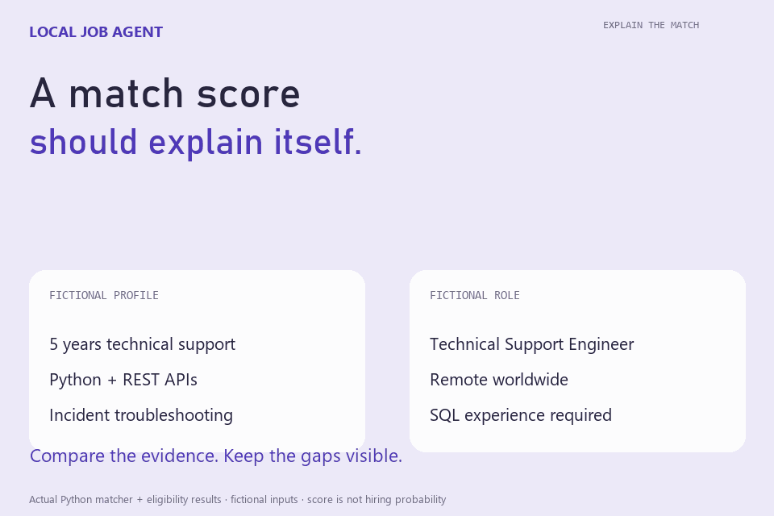

# Local Job Agent

A Python proof of concept for job discovery, Pakistan eligibility checks, transparent match scoring, clarification questions, resume drafts, and optional ATS form filling. Ambiguous geography and unknown applicant counts stay visible.

## Run

Create a virtual environment and run `python -m pip install -e .`. Copy `config/profile.example.yaml` to `config/profile.yaml` and `config/search.example.yaml` to `config/search.yaml`; enter your own verified facts. Run `python -m job_agent doctor`. Network discovery is best effort and depends on the public guest jobs surface.

Run `python -m unittest discover -s tests -v` for offline checks. The GIF runs the real matcher and eligibility classifier on fictional jobs and a fictional profile. No resume or application history is included.

External ATS autofill is a prototype; submission requires an explicit `--submit` instruction. Unknown fields block automatic submission. LinkedIn Easy Apply stays manual.

## Demo

The demo records actual local interactions with fictional inputs. Cursor movement, camera zooms and captions are added for readability. See CREDITS.md for the exact recording setup.

## Source references

See [Credits and source references](CREDITS.md) for the upstream tools, libraries and fonts used, and details of the workflow recording.

Run `python examples/offline_demo.py` for the fictional matching and eligibility example used in the demo. It does not discover jobs or submit applications.

[Download the full-motion recording](docs/demo.mp4).

[Try the demo and a practical exercise](docs/QUICKSTART.md).
